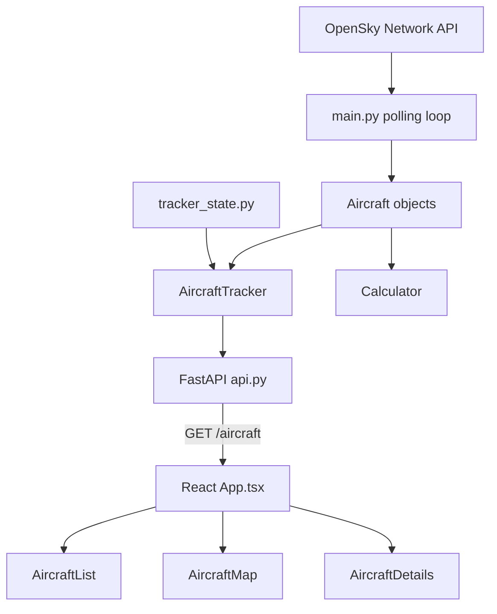

# JacobSky — Baseline Architecture and Design Assessment

## 1. Purpose

JacobSky is an aircraft-tracking application that retrieves aircraft data from the OpenSky Network API and displays it in a React dashboard. The current geographic focus is the Thessaloniki region of Greece.

This document records the existing design before the planned Object-Oriented Design Patterns refactoring. Its purpose is to establish a clear before-and-after comparison for the course project.

## 2. Baseline scope

The baseline is based on the source code inspected on October 21, 2026.

The following files already contained uncommitted changes before this document was created:

- `aircraft_tracker.py`
- `api.py`
- `frontend/src/App.tsx`
- `main.py`
- `to_do.txt`

These existing modifications must be preserved and distinguished from future refactoring changes.

A search for common Python and TypeScript test-file naming patterns found no matching files. This does not prove that no other forms of testing exist.

## 3. Technology stack

- Python for tracking and calculations.
- `requests` for OpenSky HTTP requests.
- FastAPI for the backend API.
- Python threading for background polling.
- React and TypeScript for the frontend.
- React Leaflet and Leaflet for the map.
- OpenStreetMap for map tiles.
- Vite for frontend development.

## 4. Architecture and data flow

The application currently follows this flow:

1. `main.py` requests aircraft state vectors from OpenSky.
2. It parses provider-specific arrays and converts altitude to feet and speed to miles per hour.
3. It creates new `Aircraft` objects or updates existing ones.
4. `AircraftTracker` stores aircraft in a dictionary keyed by callsign.
5. `api.py` exposes the current collection through the `/aircraft` endpoint.
6. The React frontend polls that endpoint and updates its local state.
7. The frontend filters aircraft and displays them in a list, on a map, and in a details panel.

`tracker_state.py` creates a module-level `AircraftTracker` instance shared by the polling loop and API.

## 5. Module responsibilities

### `main.py`

- Requests aircraft data from OpenSky.
- Defines the geographic bounding box.
- Parses provider-specific state-vector arrays.
- Converts altitude and speed units.
- Creates and updates aircraft objects.
- Prints tracked aircraft information.
- Controls polling and responds to a stop event.

The inspected implementation waits 15 seconds after a successful polling cycle. The unsuccessful HTTP-response branch does not use that wait.

### `aircraft.py`

`Aircraft` stores current aircraft data and a dictionary of historical position snapshots. It delegates geometric calculations to `Calculator` and provides methods for updating data, calculating distance and bearing, estimating nearest approach, and formatting information.

`Position` represents a historical snapshot.

### `aircraft_tracker.py`

`AircraftTracker` stores aircraft by callsign and supports insertion, callsign display, sorting by distance, and printing aircraft information. Its `aircrafts` dictionary is publicly accessible.

### `calculator.py`

`Calculator` provides static methods for haversine distance, bearing, compass direction, approach/departure classification, nearest-approach distance, and estimated time to nearest approach.

### `tracker_state.py`

Creates the shared module-level `AircraftTracker` instance.

### `api.py`

Creates the FastAPI application, starts the polling loop in a background thread during application startup, and signals it to stop during shutdown.

- `/` returns a health message.
- `/aircraft` returns aircraft data as JSON.
- CORS permits the configured local frontend origins.

### Frontend

- `App.tsx` manages aircraft data, selection, search, filtering, and polling.
- `types/aircraft.ts` defines the frontend aircraft interface.
- `AircraftList.tsx` displays selectable aircraft cards.
- `AircraftMap.tsx` displays aircraft markers using React Leaflet.
- `AircraftDetails.tsx` displays the selected aircraft's details.

## 6. Current behavior

- Aircraft data is retrieved from OpenSky using a geographic bounding box.
- Callsign is used as the tracker dictionary key.
- Existing aircraft are updated when they appear in a response.
- The inspected polling loop does not remove aircraft absent from a response.
- The backend exposes the tracker collection through a JSON endpoint.
- The frontend fetches immediately and polls every five seconds.
- Search and distance/altitude filters operate in the frontend.
- Aircraft can be selected from the list or map.

## 7. Design limitations and issues to investigate

1. **Multiple responsibilities in `main.py`:** HTTP retrieval, parsing, unit conversion, object lifecycle management, output, and timing are combined.
2. **Provider coupling:** OpenSky's numeric state-vector indexes are accessed directly in the polling loop.
3. **Shared mutable state:** The API and polling thread access the same tracker without explicit synchronization in the inspected code.
4. **Limited encapsulation:** Other modules access the tracker's public dictionary directly.
5. **Aircraft lifecycle:** The tracker has no removal method in the inspected implementation, and the polling loop does not reconcile missing aircraft.
6. **Error handling:** Request exceptions, timeouts, and invalid JSON are not explicitly handled in the inspected loop. An unsuccessful HTTP status calls `exit()`.
7. **Side effects:** Domain objects and the tracker print messages directly.
8. **Hard-coded configuration:** API URLs, coordinates, and polling intervals are embedded in the source.
9. **Testing:** The search found no files matching common Python or TypeScript test-file naming patterns.
10. **Potential history defects:** `get_approach_speed_towards_user()` contains suspicious counter and indexing behavior that needs targeted testing. `update_info()` does not visibly recalculate `bearing_from_user` before recording a new history snapshot.
11. **Zero velocity:** `main.py` replaces a calculated speed of zero with one rather than representing stationary aircraft explicitly.
12. **Selection behavior:** The selected aircraft is looked up in the filtered collection, so filtering it out hides its details.
13. **Fetch errors:** Frontend fetch failures are logged to the console but are not shown as a dedicated connection-error state.

These are observations and candidates for investigation, not all confirmed defects.

## 8. Frontend data inconsistencies

The backend calculates distance in statute miles and converts speed to miles per hour.

The aircraft list uses miles and mph, but the map popups and details panel label distance as nautical miles and speed as knots. Those labels do not match the current backend data contract.

The header says `LIVE DATA`, while the footer and details panel retain simulated-data labels. These should be reconciled with the actual data source.

## 9. Candidate design patterns

Patterns should be chosen based on the course requirements and concrete problems in the existing implementation.

- **Adapter:** Isolate OpenSky response parsing behind an application-owned interface.
- **Strategy:** Make aircraft-analysis or tracking policies interchangeable.
- **State:** Represent explicit aircraft lifecycle transitions if required.
- **Command:** Encapsulate tracking actions where this improves orchestration or testing.
- **Observer:** Notify multiple consumers about tracking events if needed.

These are possible future directions; they are not implemented patterns in the baseline.

A missing-aircraft policy must distinguish a successful response that omits an aircraft from a failed API request. Absence from a snapshot alone does not prove that an aircraft is out of range or has lost its signal.

## 10. Baseline verification plan

Establish reproducible checks for:

- Distance, bearing, and nearest-approach calculations.
- Zero-velocity and boundary cases.
- Aircraft creation, updates, and history snapshots.
- Tracker insertion, replacement, sorting, and removal.
- OpenSky response parsing.
- Failed requests and malformed responses.
- API response structure.
- Aircraft lifecycle transitions, if implemented.
- Frontend filtering, selection, and unit labels.

Record test commands, outcomes, and remaining limitations during the refactoring.

## 11. Baseline checklist

- [x] Inspect core Python modules.
- [x] Inspect the FastAPI endpoints and shared tracker.
- [x] Inspect the main React component and aircraft display components.
- [x] Record existing uncommitted changes.
- [x] Search for common test-file naming patterns.
- [ ] Run and record baseline verification checks.
- [ ] Verify this document against the working tree.
- [ ] Consider a separate Git commit before implementation changes.

## 12. Change log

Initial baseline documentation, prepared before the planned design-pattern refactoring. This document does not itself change application code.